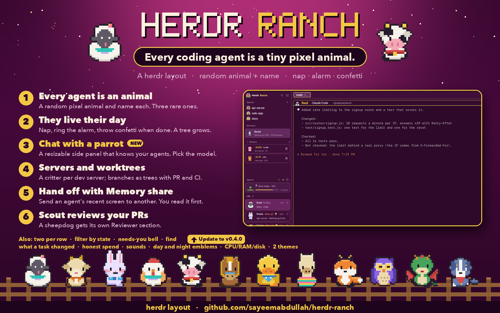
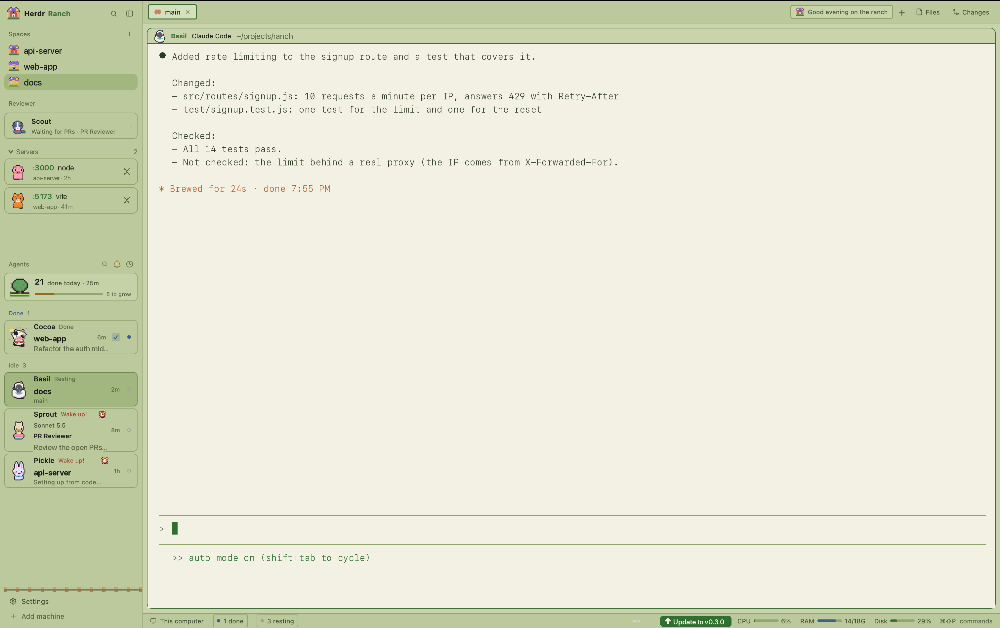
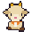
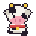
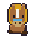
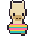
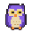
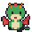

<div align="center">


# Herdr Ranch

**Every coding agent is its own pixel animal on a ranch.**<br>
**A herdr layout with a skin, a ranch board and a few tools that help you work.**
<br>
<sub>Built on the structure of <a href="https://github.com/joaovitorwoliveira/herdr-middle-earth">herdr-middle-earth</a> (MIT).</sub>

<p><a href="https://github.com/sayeemabdullah/herdr-ranch/actions/workflows/ci.yml"></a> <a href="https://herdr.dev"></a> <a href="https://nodejs.org"></a> <a href="LICENSE"></a></p>

[Install](#install) · [Update](#update) · [What you get](#what-you-get) · [The cast](#the-cast) · [What it runs](#what-it-runs) · [Develop](#develop) · [Contributing](CONTRIBUTING.md)

<br>



</div>

<br>

## What you get

<table>
<tr>
<td width="33%" valign="top">

### A cast, not a list
Each agent is its own pixel animal with a random name: 8 common, 3 rare, and a fixed sheepdog for the PR Reviewer. They step while they work, nap when they rest and wear a badge when they need you.

</td>
<td width="33%" valign="top">

### Clean terminal
The terminal stays plain: no background art, nothing on the right. CPU, RAM and disk sit in the status bar. Light and dark themes follow your system.

</td>
<td width="33%" valign="top">

### Tools for developers
Warnings before an agent runs out of context or quota, or gets stuck. What each task changed. Spend per agent and per day. One list of every agent waiting on you.

</td>
</tr>
</table>

### The animals live their day

| State | What you see |
|---|---|
| **Working** | the animal steps (two frames, every 800 ms) and three square dots bounce 1-2-3-2-1 beside its name |
| **Resting** | for 2 minutes it stands and bobs |
| **Napping** | after 2 minutes it lies down with its eyes closed and a floating Z |
| **Wake up!** | after 5 minutes it stands again and a pixel alarm clock rings beside its name |
| **Needs you** | a red badge on the animal; the card says "Needs you"; the bell rings |
| **Done** | a gold badge and confetti until you look at it; a ✓ tucks it into the barn until its next task |

Looking at an animal (focusing its pane) resets it to "Resting". Sub-agents show as baby animals beside their parent, three at most and then `+N`.

### The sidebar

- **Spaces** with arch-badge emblems (barn, silo, haystack, pond, windmill, orchard, fence). The sky follows your clock: dawn, day, dusk, night with a moon and stars. A star twinkles while an agent in that space is working.
- **Reviewer.** A space where [PR Reviewer](https://github.com/sayeemabdullah/herdr-PR-reviewer)'s PR Panel (or its watcher) is running moves out of the list into a section of its own under Spaces. The space's name doesn't matter, and a space that only has "PR Reviewer" in its name (say, where you write the plugin) stays a normal space: Scout the sheepdog, what it is doing (Reviewing, Needs you, Review done, Waiting for PRs), one click to the space. Claude reviews the pull requests you're asked to review there.
- **Ranch board.** Tasks done today, work time and spend, an apple tree that grows with your day (stages at 1, 4, 8, 13, 19 and 26 tasks, blossoms at 30, droops while someone has waited on you for over 5 minutes), and a gauge for the lowest 5-hour quota left.
- **Agent cards.** The animal, its name (click to rename), its state, the model and cost, the space, the tab title, an **HP** bar (context used, green then yellow then red) and an **SP** bar (5-hour quota left), and after a task what it changed.
- **Needs-you bell.** Rings with a red count in the Agents header. Click it for every waiting animal across all spaces, longest wait first; click a row to jump to that agent.
- **Find.** The magnifier filters animals by name, animal, space, program or state; Enter jumps to the first match.

### Developer helpers

- **Warnings.** A toast in the animal's voice, once, when an agent's context is 80% full, when the 5-hour quota is down to 10%, or when an agent has been working for 5 minutes with an unchanged screen ("looks stuck"). Click it to go to that agent.
- **What a task changed.** When an agent finishes, its card and the "All done" toast show something like `✎ 3 files +120 −30`: the change in its git folder between the start and the end of the task. New untracked files aren't counted, a commit during the task clears the numbers, and remote machines are skipped.
- **Spend.** Each card shows its session cost; the board adds up today's. Click the amount on the board to start counting from zero. The cost is read only from the status-line row, so a dollar amount in the chat is never counted.
- **Toasts** like "Clover: baa! All done", with the animal's picture, and system banners when herdr is in the background.

### Space emblems

Every space gets one of seven arch-badge emblems, the first one nobody else has. The sky changes with your clock (dawn 5-8, day 8-17, dusk 17-20, night), and a star twinkles in the corner while an agent in that space is working.

<table>
<tr><th></th><th>barn</th><th>silo</th><th>haystack</th><th>pond</th><th>windmill</th><th>orchard</th><th>fence</th></tr>
<tr><th>Dawn</th><td align="center"></td><td align="center"></td><td align="center"></td><td align="center"></td><td align="center"></td><td align="center"></td><td align="center"></td></tr>
<tr><th>Day</th><td align="center"></td><td align="center"></td><td align="center"></td><td align="center"></td><td align="center"></td><td align="center"></td><td align="center"></td></tr>
<tr><th>Dusk</th><td align="center"></td><td align="center"></td><td align="center"></td><td align="center"></td><td align="center"></td><td align="center"></td><td align="center"></td></tr>
<tr><th>Night</th><td align="center"></td><td align="center"></td><td align="center"></td><td align="center"></td><td align="center"></td><td align="center"></td><td align="center"></td></tr>
</table>

### Top bar, panes and footer

A **Herdr Ranch** sign whose barn follows the clock; gold-boxed pixel tabs; a **ranch strip** in the tab bar that rotates through who is working, tasks done today and Scout on watch (and, in red, whoever needs you); a pane header with the animal's name; a pixel fence over Settings and Add machine. Dialogs like *Close space?* use the same colours with a gold main button.

> [!NOTE]
> Some numbers need the agent's screen to show them. Context, quota and cost are read from a Claude Code-style status line (`ctx 5%`, `5h 32%`, `$0.01`). An agent whose screen doesn't show them just doesn't get that bar.

### Two themes

Both follow your system's light or dark mode, and the animals stay readable on each.

<table>
<tr>
<td align="center" width="50%"><br><b>Ranch Dusk</b><br><sub>plum, gold accents</sub></td>
<td align="center" width="50%"><br><b>Ranch Meadow</b><br><sub>light sage, green accents</sub></td>
</tr>
</table>

## Install

You need **herdr-app 0.1.16** (macOS tested; Linux and Windows follow the docs and are untested). Python is only needed to change the art, Node only for the tests.

```sh
git clone https://github.com/sayeemabdullah/herdr-ranch
cd herdr-ranch
./install.sh
```

The script copies the layout, two themes and seven mods into `~/.config/herdr-app` (anything it replaces goes to `backups/herdr-ranch-<time>/`), checks each mod with `herdr-app check`, and switches the window to **Herdr-Ranch**. `RANCH_NO_SWITCH=1 ./install.sh` installs without switching.

- `ctrl-shift-l` switches layouts, so your old one is one key away.
- Pick it in **Settings → Look → Layout** (it shows as *Herdr-Ranch*; herdr builds that name from the file name).
- Images load lazily: right after an install the first frame can show empty slots for a few seconds.
- Optional system banners on macOS: `brew install terminal-notifier`, then open its app once and allow notifications.

### Update

Herdr Ranch has no automatic updates. To get a newer version, pull it and run the installer again:

```sh
cd herdr-ranch
git pull
./install.sh
```

- Read [CHANGELOG.md](CHANGELOG.md) first to see what changed.
- The installer is safe to re-run: it copies the new files over the old ones and moves whatever it replaces to `backups/herdr-ranch-<time>/`, so a mod you edited in `~/.config/herdr-app` is backed up, not merged. Copy your changes back from there if you want to keep them.
- It switches the window to Herdr-Ranch again; `RANCH_NO_SWITCH=1 ./install.sh` updates without switching.
- herdr reloads the mods by itself, so no restart is needed. The first frame can show empty picture slots for a few seconds.
- Your animals' names and colours, the board's counts and your settings are kept: they live in herdr's shared values and the mods' local storage, not in the installed files.

### Uninstall

Delete what the installer added (nothing else is touched), then pick another layout:

```sh
cd ~/.config/herdr-app
rm -rf layouts/Herdr-Ranch.* themes/ranch-*.json mods/flock mods/flock-status mods/flock-toast mods/meadows mods/ranch-chrome mods/ranch-pane mods/ranch-tabs
```

## The cast

<table align="center">
  <tr>
    <td align="center"><br><b>Sheep</b><br><sub>common</sub></td>
    <td align="center"><br><b>Goat</b><br><sub>common</sub></td>
    <td align="center"><br><b>Rabbit</b><br><sub>common</sub></td>
    <td align="center"><br><b>Chicken</b><br><sub>common</sub></td>
  </tr>
  <tr>
    <td align="center"><br><b>Cow</b><br><sub>common</sub></td>
    <td align="center"><br><b>Horse</b><br><sub>common</sub></td>
    <td align="center"><br><b>Duck</b><br><sub>common</sub></td>
    <td align="center"><br><b>Llama</b><br><sub>common</sub></td>
  </tr>
  <tr>
    <td align="center"><br><b>Fox</b><br><sub>rare · 6%</sub></td>
    <td align="center"><br><b>Owl</b><br><sub>rare · 3%</sub></td>
    <td align="center"><br><b>Dragon</b><br><sub>rare · 1%</sub></td>
    <td align="center"><br><b>Scout</b><br><sub>the PR Reviewer</sub></td>
  </tr>
</table>

A new agent gets one of the 8 common animals nobody is using; when all 8 are taken it takes one of the least used, in alternate colours. About 1 agent in 10 is a rare animal instead (fox 6%, owl 3%, dragon 1% of all agents). Rares never use up a common slot, and Scout is never given to an agent. The animal, its name and its colour are kept per terminal, so they survive restarts.

## What it runs

These mods are trusted code. Before you install, know that:

- `flock` reads each agent's screen with `hc read` (model, context, quota, cost, whether it looks stuck) every 15 seconds, runs `git diff --shortstat HEAD` (read-only) in each agent's folder on this computer, and posts warning toasts.
- `meadows` runs `git` (`rev-parse`, `symbolic-ref`, `rev-list`) in each space's folder and watches that repo for changes, to show the branch, and runs `hc machine ls`. This is the same as herdr's own spaces list.
- `flock-status` runs `ps`, `vm_stat`, `sysctl` and `df` (and `nproc` and `cat /proc/meminfo` on Linux) every 5 seconds for the meters.
- `flock-toast` runs `terminal-notifier` or `osascript` (macOS) or `notify-send` (Linux) for system banners when the window is in the background.
- `ranch-chrome`, `ranch-tabs` and `ranch-pane` only draw: they read herdr's lists and the values the others publish.
- **Nothing uses the network.**

`herdr-app check` prints "mod called hc" for `flock`: that is expected.

## Develop

Every picture is drawn in code in `tools/sprites.py` (24x24 animals, 20x20 emblems with four skies, small icons): edit the drawing functions, never the SVGs, then regenerate:

```sh
python3 tools/sprites.py
python3 tools/banners.py            # system-banner PNGs; needs Pillow
node --test                         # casting, vitals, stats, warnings, board
python3 -m unittest discover -s tools
```

| Folder | What |
|---|---|
| `layouts/` | `Herdr-Ranch.json` and its preview |
| `themes/` | `ranch-dusk.json`, `ranch-meadow.json` |
| `mods/flock` | the agent cards, board, bell, find (clone of herdr's `agents`) |
| `mods/meadows` | spaces and the Reviewer section (clone of `spaces`) |
| `mods/flock-status`, `flock-toast` | status bar and toasts |
| `mods/ranch-chrome`, `ranch-tabs`, `ranch-pane` | sign and footer, tab bar with the ranch strip, pane header |
| `tools/` | the art and its tests |

[RECIPE.md](RECIPE.md) is the full brief the layout can be rebuilt from (the format herdr.dev's gallery uses). See [CONTRIBUTING.md](CONTRIBUTING.md) before opening a pull request: changes go through PRs with Conventional Commit titles, never straight to `master`.

## Credits

- Built on the structure of [herdr-middle-earth](https://github.com/joaovitorwoliveira/herdr-middle-earth) by joaovitorwoliveira (MIT): the layout structure and the mods `flock`, `flock-toast`, `flock-status` and `meadows` are adapted from its mods, which are clones of herdr's own. Its copyright notice is in [NOTICE.md](NOTICE.md).
- Ideas from [Pixel HQ](https://github.com/bnhan2710/pixel-hq) by bnhan2710: pets that nap and get an alarm, the needs-you bell, the ranch board and tree, find, and tucking finished work away. All art and code here are new.
- The Reviewer section is made for [PR Reviewer for herdr](https://github.com/sayeemabdullah/herdr-PR-reviewer).
- [herdr](https://herdr.dev) itself.

## License

[MIT](LICENSE). The part adapted from herdr-middle-earth keeps its own copyright notice in [NOTICE.md](NOTICE.md).
