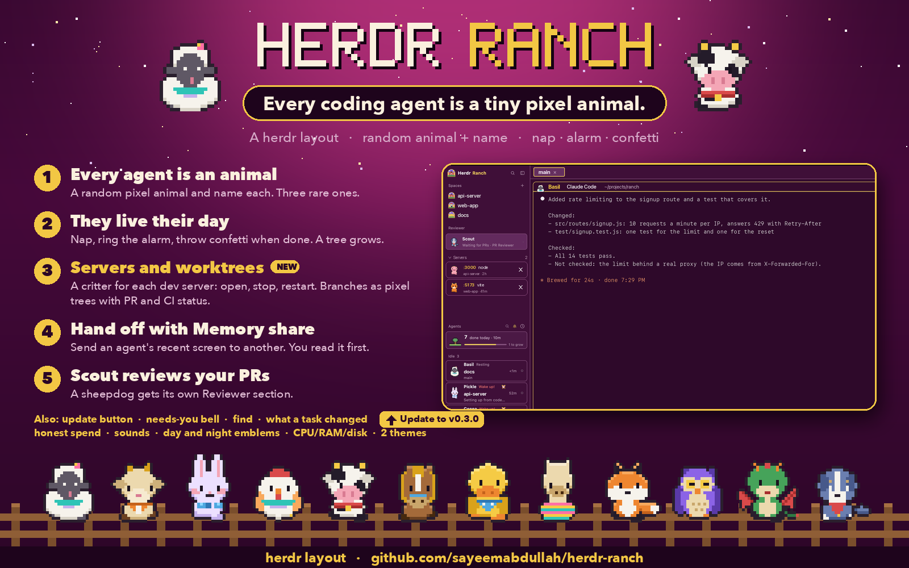

# Herdr Ranch

Your coding agents become animals on a ranch. Each agent is its own pixel animal with a random name: it steps while it works, naps when it has rested a while, and shows a badge when it needs you or is done. The PR Reviewer is a sheepdog with a section of its own. A ranch board counts the day's finished tasks and grows a tree. The terminal stays plain, nothing sits on the right, and the status bar shows CPU, RAM and disk. A light theme (Ranch Meadow) and a dark one (Ranch Dusk, plum), with gold accents and pixel-boxed buttons.

The light theme, Ranch Meadow, is in `preview-light.png`.

## What you see

A row with no system title bar (`"titlebar": "none"`). The macOS window buttons sit at `[12, 16]`. UI font `.SystemUIFont`. A 1px `border` divider runs between the columns. The right side of the window has nothing in it.

- **Sidebar, left, 268px** (min 44, max 480, not resizable), on `chrome`:
  - **Brand**, 46px: `ranch-chrome` (clone of `workspace-chrome`), a window drag area: a 24px barn emblem whose sky follows the clock (dawn 5-8, day 8-17, dusk 17-20, night) and "Herdr" in `foreground` with "Ranch" in `accent` (gold), both bold; search and sidebar-toggle buttons on the right.
  - **Spaces** (`meadows`), weight 2, min 90: each space shows a 20px arch-badge emblem (a gold frame, a two-tone sky, a strip of grass; a 20x20 picture drawn 1:1). Seven emblems in order: barn, silo, haystack, pond, windmill, orchard, fence. Each has four skies: dawn (pink over orange), day, dusk (violet over orange) and night (navy with stars and a moon); the file is `<name>.svg` for day and `<name>-dawn|dusk|night.svg`. A space where PR Reviewer's panel or watcher runs (a pane whose title is `pr-panel`, `PR Panel` or `PR watcher`, or whose terminal's foreground program is `.../pr-reviewer.../src/panel.js`, `watcher.js` or `doctor.js`, or the `pr-panel` command; its name doesn't matter, and a space that only has "PR Reviewer" in its name is an ordinary space) leaves this list and shows in a **Reviewer** section right under the last space: a header "Reviewer" and a 50px card (1px `border`, `selected` fill when active) with the 32px sheepdog Scout, "Scout" in semibold, and "<Reviewing|Needs you|Review done|Waiting for PRs> · <space name>"; a click selects the space.
  - **Agents** (`flock`), weight 3, min 90. A header: "Agents" in `dim` and, on the right, a "✓ N in the barn" chip when animals are tucked away, a magnifier (find), a bell with a red count (needs-you list) and the sort icon. Under it the **ranch board** (54px card, 1px `border`, `raised` at 33%): a 36px tree, a bold count of tasks done today with "done today · <work time> · $<spend>", a 4px progress bar to the next tree stage with "N to grow" (or "someone's waiting" in `blocked` when a waiting agent has waited over 5 minutes, which also droops the tree), and, only when an agent's screen shows a quota, a 5-segment gauge "SP n%". Then one card per agent: a 36px animal (a 24x24 picture) beside a stack of lines. First line: the animal's name in semibold (click to rename), its status word (Working, Needs you, Resting, Napping, Wake up!, Done), up to three 14px baby animals when it has sub-agents (then "+N"), a ringing 14px alarm clock when it is on "Wake up!". Then the model and cost ("Haiku 5.5 · $0.01"), the space in semibold, the tab title in `dim`, an HP bar (context used) and an SP bar (5-hour quota left), and, after a task, "✎ 3 files +120 −30".
  - **Footer**, 78px: `ranch-chrome` with `{ "footer": true }`: a 9px pixel fence (wooden posts every 8 pixels and two rails, `mods/ranch-chrome/fence.svg`, 480x9 clipped to the width), then Settings and Add machine as 28px rows with a 2px `chrome` border that turns `accent` on hover.
- **Work column**, right: tabs 42px (`ranch-tabs`, a clone of `tabs`, window drag area): square (radius 4) tabs with a 2px border, gold (`accent`) when active; a **ranch strip** before the `+` button (26px, 2px `border`, `canvas` fill): the 16px barn emblem of the hour and one line that changes every 4 seconds ("Good evening on the ranch", "Basil is working" or "N animals at work" or "N resting in the meadow", "N done today", "Scout is on watch"); when anyone needs you the strip shows only "<Name> needs you" (or "<Name> and N more need you") in `blocked`. Files and Changes are 2px-bordered boxes, gold when on. A body with padding 8 and gap 8 whose panes are cards (radius 10, 1px `border` that turns `accent` on focus, 30px `ranch-pane` header always shown: the agent's 26px animal and its name in bold gold, the program, the folder, then a spinner while working or a 2px-boxed "Needs you" (red) or "Done" (gold) chip; `canvas` fill and a 2px bottom border, `accent` on the focused pane; hover shows split, zoom and close); a Files/Changes stack (368px, min 280, max 900) that starts hidden.
- **Status bar**, 28px (`flock-status`), on `chrome`: the machine, the branch, one colored dot and count per state that has agents ("N needs you", "N done", "N working", "N resting"), or "The ranch is quiet" with none; then three meters, `CPU`, `RAM`, `Disk`, each a label, a 46x5 bar and a value (`34%`, `12/18G`, `29%`); then the palette hint on the far right.

Themes, set on the layout as `{ "light": "ranch-meadow", "dark": "ranch-dusk" }` (files `themes/ranch-meadow.json`, `themes/ranch-dusk.json`):

- **Ranch Dusk** (the plum from the author's own setup): background `#33062b`, text `#f3e9f0`. Colors: accent `#f2c744`, chrome `#45093a`, canvas `#3a0730`, popover `#5c1b50`, border `#8f4f80`, input `#8a4a7c`, hover `#5f2055`, selected `#6a2560`, raised `#6d2b61`, solid `#f2c744`, solid_foreground `#33062b`, accent_foreground `#33062b`, muted `#d1b3ca`, dim `#b995b0`. Dialogs and menus (Close space?, rename, popups) read these: Cancel is `raised`, the main button gold with plum text. Herdr draws those dialogs itself; only the theme colours restyle them.
- **Ranch Meadow**: background `#f3f1e2`, text `#2c3a22`. Colors: accent `#2f6f2f`, chrome `#b9ca98`, canvas `#c6d4a8`, popover `#e4ecd0`, border `#8fa56a`, input `#6d8a48`, hover `#abc085`, selected `#9db878`, raised `#d3e0b8`, solid `#2f6f2f`, solid_foreground `#f7f5e6`, accent_foreground `#f7f5e6`, muted `#3e4f2e`, dim `#586b44`. Chrome is a mid sage so the white and cream animals stay visible.

## How it behaves

- **Casting.** A new agent gets one of 8 common animals: sheep, goat, rabbit, chicken, cow, horse, duck, llama. It takes a random one nobody listed is using. When all 8 are in use, it takes a random one among the least-used and gets the alternate colours (`-alt` sprites). One agent in ten (`RARE_CHANCE = 0.1`) is a rare animal instead: fox (60% of rares), owl (30%), dragon (10%, about 1 in 100 overall). Rares never use up a common slot. The animal, its name and its colour variant are kept per terminal address in shared `flock.cast`, `flock.names`, `flock.variant`, so they survive restarts. They are dropped when the terminal closes.
- **Names.** Random from a pool of 28 farm-style names (Clover, Biscuit, Pepper, Maple, Waffle...), unused ones first.
- **Working:** status word "Working". Two frames swap every 800ms (the feet step, the body bobs one pixel down). Three square dots after the word, one lit at a time, bouncing 1-2-3-2-1 over 1200ms. Only working agents show the dots.
- **Resting (idle), by how long:** under 2 minutes the animal stands and bobs (two frames every 1800ms), status word "Resting". From 2 minutes (`NAP_AFTER`) it lies down with its eyes closed, two frames every 1800ms, the second lifting it one pixel and adding a grey "z" in the top-left corner; "Napping". From 5 minutes (`ALARM_AFTER`) it stands again, bobbing every 800ms, the status word "Wake up!" turns `blocked` and a 14px pixel alarm clock rings beside it (two frames, 500ms). Looking at an animal (focusing its pane) resets this to "Resting". The clock starts when the agent last changed state.
- **Needs you (blocked):** a still animal with a red badge (a 6x6 red disc with a white `!`) in the top-left corner; status word "Needs you".
- **Done:** a still animal with a gold badge (a 6x6 gold disc with a white check) in the top-left corner and two frames of falling confetti laid over it (a transparent 36px picture, every 1200ms) until you look at it; status word "Done". A 16px "✓" box on the card tucks the animal away ("N in the barn" chip) until its next task, when it comes back by itself; the chip brings everyone back at once.
- **Ranch board.** Each working-to-idle change that lasted at least 20 seconds (`MIN_TASK`) counts one task and adds its duration (kept in the flock mod's `localStorage` key `ranch`, reset each day, and published as shared `ranch.today`). The tree has 8 stages by tasks done: 0, then 1, 4, 8, 13, 19, 26 and blossoms at 30 (14x14 pictures `icons/tree-<n>[-droop].svg`). Spend is each session's highest `$` cost seen, read only from a row that looks like the status line (it shows `ctx`, a model name, `5h` or `last $`), summed; clicking the amount makes what each session has cost so far its zero.
- **Needs-you bell.** The bell rings (two frames, 700ms) while anyone is blocked and carries a red count; click it for a popup (300px wide) listing every waiting animal across all spaces, longest wait first: a 30px blocked animal, its name, "<space> · <program>" and the wait in red; a click focuses that pane and closes the popup.
- **Find.** The magnifier shows a text box; animals that do not match (name, animal, space, program, state) fade to 25%; Enter focuses the first match.
- **Rename.** Clicking an animal's name opens a 320px popup with a text box (Enter saves, Esc cancels); an empty name gives a fresh random one. It writes shared `flock.names`, which the toasts and pane header read.
- **Baby animals.** A sub-agent shows as a 14px copy of its parent beside its name (three at most, then "+N"); working ones are fully opaque, the others 50%.
- **Warnings.** Every 15 seconds the flock mod reads the screen of each agent that is working, focused, just changed state, never read, or last read over 2 minutes ago (`needsRead`); the others keep their numbers. It posts a warning toast (`notify`, level warning, the animal's blocked picture, click focuses the pane) once when context reaches 80% (again only after it falls below 70%), once when the 5-hour quota is at 90% used (again after it falls below 80%; at most one such toast per 10 minutes across agents), and once when an agent has been working for 5 minutes and its screen is unchanged once digits, spinners and symbols are ignored.
- **Memory share (handoff).** On a hovered card with an animal, when there is more than one agent, a "↗" button opens a 480x600 dialog (`openOverlay({ mod: "flock", kind: "dialog", props: { handoff: <terminal>, from: <name> } })`): the other agents as rows (animal, name, space, state; the selected row gets an `accent` border), a text box for the first line (empty gives "Context from <name>, so you can pick this up:"), buttons 20, 40 and 80 for how many screen lines to include, and a read-only preview of the exact message: the intro, `--- <name>'s recent screen ---`, the last N conversation lines of `hc read <terminal>` (separators, the prompt box and the status line removed, at most 4000 characters, the end kept), `--- end ---`. If the target is working, a note says so. **Send** is disabled until a target is picked and the screen is read; it runs `hc send <target> <message>` once and closes the dialog, or shows "Could not send". Nothing is ever sent without the button.
- **Handoff.** On a hovered card with an animal, when there is more than one agent, a "↗" button opens a 480x600 dialog (`openOverlay({ mod: "flock", kind: "dialog", props: { handoff: <terminal>, from: <name> } })`) in the ranch look: a header with the sender's 32px portrait in a 2px `accent` box and "Hand off <name>'s screen"; a "SEND TO" list (gold small caps labels) of the other agents as 40px rows (radius 4, 2px `border`, `accent` when chosen, the animal, its name and space, a mood chip, a radio dot); a "MESSAGE" text box whose placeholder is "Context from <name>, so you can pick this up:" (empty uses it); a "PREVIEW" label with a segmented switch 20, 40, 80, 160, 300 and a small "custom" text box (any whole number 1 to 1000, `parseLines`; the box gets an `accent` border while a custom number is in use); a read-only preview on `canvas` with a 3px `accent` bar on its left and the length in characters; a yellow note when the target is working; Cancel and a gold **Send to <Name>** button. The preview is exactly the message: the intro, `--- <name>'s recent screen ---`, the last N conversation lines of `hc read <terminal>` (separators, the prompt box and the status line removed, at most 12000 characters, the end kept), `--- end ---`. **Send** is disabled until a target is picked and the screen is read; it runs `hc send <target> <message>` once and closes the dialog, or shows "Could not send". Nothing is ever sent without the button.
- **Warnings.** Every 15 seconds the flock mod reads each agent's screen. It posts a warning toast (`notify`, level warning, the animal's blocked picture, click focuses the pane) once when context reaches 80% (again only after it falls below 70%), once when the 5-hour quota is at 90% used (again after it falls below 80%; at most one such toast per 10 minutes across agents), and once when an agent has been working for 5 minutes and its screen is unchanged once digits, spinners and symbols are ignored.
- **What a task changed.** Each agent's folder (this computer only) is read with `git diff --shortstat HEAD` every 15 seconds; the difference between the start of a task and its end shows as "✎ 3 files +120 −30" on the card for 2 hours, in shared `flock.summary`, and on the "All done" toast. Untracked files are not counted, and a commit during the task clears the numbers.
- **Day and night.** Space emblems and the brand barn follow the clock (refreshed every 5 minutes). A 5px star twinkles in the corner of an emblem while that space has an agent working.
- **Animal sounds.** When a finished or needs-you toast appears (`flock-toast` `init()`), `playSound("mods/flock/sounds/<animal>.wav")` plays that animal's sound, in the window or behind another app, unless shared `flock.sound` is `false`. The ♪ button in the Agents header toggles it (a dim "♪×" when off). herdr's own alert sound is separate and still plays. Warning toasts and Scout make no sound.
- **Toasts** (`flock-toast`, set as the layout's `toast`): "<program> finished" and "<program> needs you" become "<Name>: <sound>! All done" or "<Name>: <sound>! Needs you" (sounds: Baa, Meh, Squeak, Bawk, Moo, Neigh, Quack, Hum, Yip, Hoo, Roar), with the matching 28px animal. The body reads "<program> · <body>". When the Herdr window is not active the same text goes to the system with the animal's 120px PNG.
- **Dock badge:** the number of agents that need you, set with `setBadge` only when it changes, cleared at zero.
- **Meters** refresh every 5 seconds; a meter shows `--` when its command fails and the others keep updating.
- Everything else (sorting, pinning, sub-agent rows, the sort menu) is the shipped `agents`, `spaces`, `toast`, `tabs`, `pane` and `workspace-status` behavior.

## Built from

- **Layout:** `layouts/Herdr-Ranch.json` (herdr builds the Settings name from the file name and rejects names with a space), a clone of `main` 0.1.16 by way of herdr-middle-earth. Root keys: `theme`, `ui_font`, `toast`, `titlebar`, `traffic_lights`, `preview` (`layouts/Herdr-Ranch.png`). Blocks: `brand` (`ranch-chrome`), `spaces` (`meadows`, weight 2), `agents` (`flock`, weight 3), `sidebar-footer` (`ranch-chrome` with `footer`, 78px), `tabs` (`ranch-tabs`), `main` pane header (`ranch-pane`), `status` (`flock-status`). Shipped mods used as they are: `workspace-chrome` (its icons), `files`, `changes`, `prompt`, `confirm`, `menu`.
- **`flock`** (clone of `agents`): `casting.js` (`pickAnimal`, `drawRare`, `variantFor`, `pickName`, `COMMON`, `RARE`, `NAMES`), `agent-stats.js` (`parseModel`, `parseContext`, `parseQuota` "5h n%", `parseCost` first `$n` not after "last"), `ranch.js` (`lifeOf`, `treeStage`, `worked`), `handoff.js` (`pickContext`, `buildHandoff`), `watch.js` (`watchAgent`, `normalizeScreen`, `parseShortstat`, `changeSince`, `formatChange`). A two-frame swap is two stacked `image()`s whose `opacity` loops linearly between -6 and 7; the over-range values clamp, so each frame is fully on or off for half the period (a crisp swap, no fade). The dots use the same trick with a steep slope and different switch points. The same view serves popups by props: `{ rename }`, `{ needsList }`, `{ sortMenu }`, opened with `openOverlay({ mod: "flock", kind: "popup" })`; the text box is gpui-base `InputState` and `Input`. Sprites: `mods/flock/sprites/<id>[-alt][-work|-2|-idle|-idle-2|-blocked|-done].svg`, `confetti[-2].svg`; icons: `mods/flock/icons/alarm[-2]`, `bell[-2]`, `tree-0..7[-droop]`.
- **Servers and Worktrees sections (`meadows`, local spaces only):** `servers.js` reads `lsof -nP -iTCP -sTCP:LISTEN -Fpcn` and each process's folder (`lsof -a -d cwd`), keeps those inside a space's folder or a worktree (the deepest wins), and adds the uptime from `ps -o pid=,etime=`; refreshed every 5 s. A card shows `:port program` (the port in the accent colour, no background, like the agent cards), `space · uptime` and a barnyard critter (pig, cat, frog, hedgehog: the first one no other listed port wears, kept in `meadows.critters`; `-2` frame bobs, `-blocked` red badge when it ended; drawn in `tools/sprites.py` as `CRITTERS`, kept out of the agent cast); a click opens `http://localhost:<port>` (`cx.open_url`); the x shows "Stop?" for 4 s and a second press runs `kill -TERM <pid>`. `worktrees.js` reads `git worktree list --porcelain` per repo every 20 s and lists repos with more than one worktree, a pixel tree for each (`mods/flock/icons/tree-5` main, `tree-3` a space open, `tree-1` none); a click selects that space or runs `space.new` with the folder.
- **Dev-friendly extras:** a server that disappears without being stopped from here (`trackGone`) toasts and keeps a card with **Restart** for 60 s (`tab.new` in its space, or `space.new`, running `/bin/zsh -lc <the command ps showed>` in its folder); each non-main worktree's PR and CI come from `gh pr list --head <branch> --state all --limit 1 --json ...` every 2 minutes (`parsePr`; a failure is not retried for 10 minutes); the + button on a repo heading opens herdr's `worktree` dialog with `{ folder, machine: "", argv: ["claude"] }`; `flock` toasts when a screen shows EADDRINUSE or "port N is already in use" (`portClash` in `watch.js`, looks up the holder with `lsof -iTCP:N`).
- **`meadows`** (clone of `spaces`; `reviewer.js` decides which spaces run the PR Panel, from `spaces()`, `panes()` and `terminals()`): shared `meadows.emblems` (space id to emblem name), `mods/meadows/emblems/<name>[-dawn|-dusk|-night].svg`; the Reviewer section is drawn by the same view under the scrolling list.
- **`flock-status`** (clone of `workspace-status`): `vitals.js` (`parseCpu`, `parseMemMac`, `parseMemLinux`, `parseDisk`, `formatGB`).
- **`flock-toast`** (clone of `toast`): reads `flock.cast`, `flock.names`, `flock.variant`, `flock.summary`; posts from `init()`, not `render()`.
- **`ranch-chrome`** (clone of `workspace-chrome`), **`ranch-tabs`** (clone of `tabs`; reads shared `flock.names`, `flock.cast`, `ranch.today`; a 4-second timer rotates the strip), **`ranch-pane`** (clone of `pane`; reads `flock.cast`, `flock.names`, `flock.variant`).
- **`herdr` functions:** `agents`, `terminals`, `panes`, `spaces`, `focused`, `theme`, `shared`, `setShared`, `run` (`pane.focus`, `space.select`), `openOverlay`, `closeOverlay`, `notify`, `window`, `settings`, `setBadge`, `checking`, `exec`, `hc`, `appHome`, `layout`.
- **Programs run:** `hc read <terminal>` (model, context, quota, cost, screen), `git diff --shortstat HEAD` in each agent's folder, `hc machine ls --json` and `git rev-parse`, `git symbolic-ref`, `git rev-list` in each space's folder, with `watchFolder` on its repo (`meadows`, unchanged from herdr's spaces list), `ps -A -o %cpu`, `vm_stat`, `sysctl -n hw.ncpu hw.memsize`, `df -k /`, and on Linux `nproc` and `cat /proc/meminfo` (meters); `terminal-notifier` or `osascript` (macOS) and `notify-send` (Linux) for system banners. No network access.
- **Sounds:** `tools/sounds.py` synthesises 11 short mono 16-bit 22.05 kHz WAVs (baa saw with vibrato, moo low saw, quack two square bursts, neigh up-and-down saw sweep, squeak rising sine pairs, bawk three square bursts, meh vibrato square, hum two sines, yip rising triangle pairs, hoo two sine tones, roar saw plus smoothed noise), peak-normalised to 0.55, with the standard library only; `tools/test_sounds.py` checks length (0.1 to 1.2 s), format and level.
- **Fold and hide:** each section heading (`sectionHeader`: a 1px line, a chevron, the name, a count) folds it (localStorage `ranch.folded`, default `["worktrees"]`); the `···` button next to Spaces opens a popup (`openOverlay({ mod: "meadows", kind: "popup", props: { ranchSettings: true } })`, drawn by `settingsView`) that writes `shared("ranch.hide")` = `{ reviewer, servers, worktrees, update }` (true = hidden). Hiding Reviewer leaves Scout's space in the Spaces list; `flock-status` reads `update`.
- **Servers on Linux:** `ss -H -ltnp` for the listeners (`parseSs`), `readlink /proc/<pid>/cwd` for folders, then the same `ps` calls; `lsof` is the fallback. A process with several ports shows its lowest and `+N`; the port never shrinks or wraps. Restart runs `/bin/sh -c 'exec "${SHELL:-/bin/sh}" -lc "$0"' <command>` (the person's own shell and PATH); Update runs `/bin/sh -c`.
- **`ranch-worktree` dialog:** a ranch-styled copy of herdr's `worktree` dialog (same props `{ space | folder, action: new | open | remove, argv }`, same git work, `machine` left out so it means this computer: passing `machine: ""` made herdr fail with `unknown machine ""`). Adds a pixel tree and title, a "Goes to <folder>" preview, Cancel and a gold Create worktree button, soft red notices, and on the Open list a Delete per row (`git worktree remove`, `--force` only after the dirty check was shown, then `space.close`). The sidebar's Worktrees section opens it for **New** and for "+ N more".
- **Update button:** `flock-status` shows the installed version as dim text (`Ranch v0.2.0`; a click checks right now and toasts "up to date") and, when GitHub's latest release (`curl https://api.github.com/repos/sayeemabdullah/herdr-ranch/releases/latest`, 20 s after start then every 6 h, at most once an hour, cached in localStorage) is newer than `herdr-ranch.version`, a gold "Update to vX.Y.Z" pill left of CPU instead in herdr's folder (written by `install.sh` from `VERSION`). Click runs `tab.new` named "Update Ranch" with `/bin/zsh -lc` of `updateScript(tag)`: download `archive/refs/tags/vX.Y.Z.tar.gz`, run its `install.sh`, wait for enter. The tag is checked (digits and dots) before it reaches the command. `update.js` holds the pure parts. Bump `VERSION` in each release PR.
- **Servers and Worktrees picture:** `tools/sections_picture.py` draws the two sections from the real sprites onto the empty sidebar area of the three window screenshots and writes `assets/servers-worktrees.png`; the names are made up.
- **Preview picture:** `preview.png` is the gallery banner, drawn by `python3 tools/preview_banner.py` (Pillow) from the ranch's own sprites and `layouts/Herdr-Ranch.png`; the plain Ranch Dusk screenshot is `assets/preview-dusk.png`.
- **Memory share picture:** `assets/memory-share.png` is a screenshot of the window with the space names and the preview text replaced by made-up ones, cropped to the dialog with transparent rounded corners.
- **Demo:** `tools/demo_gif.py` (Pillow) draws `assets/demo.gif` from the same sprites and periods (36 frames of 200 ms: steps 800 ms, dots 1200 ms, alarm 400 ms, nap 1800 ms, confetti 1200 ms); it is a drawing, not a recording.
- **Art:** `tools/sprites.py` draws every picture in code, from ellipses, rectangles and polygons, then adds a 1px outline (`o`, `#2a1f2d`) and a darker bottom edge automatically: 12 characters x 7 poses (front-facing chibi figures, a big head over a small body, each with bright accessories: scarves, a bow tie, a poncho, a halter; every pose is a real redraw), 8 alternate-colour sets, 7 emblems x 4 skies, the alarm clock, bell, tree stages and confetti. Animal SVGs declare `width`/`height` 36 over a `0 0 24 24` viewBox, emblems 20 over `0 0 20 20`, icons 14, all with `shape-rendering="crispEdges"`. `tools/banners.py` (Pillow) scales the blocked and done poses 5x, nearest-neighbour, into `mods/flock/banners/`. The fence strip is `mods/ranch-chrome/fence.svg`.

## Watch out

- **Installing takes more than `layouts/` and `mods/`.** Also copy `themes/ranch-meadow.json` and `themes/ranch-dusk.json` to the home's `themes/` (otherwise the layout shows the person's own theme) and `layouts/Herdr-Ranch.png` beside the layout file. `./install.sh` does all of this on macOS and Linux, backs up what it replaces to `backups/herdr-ranch-<time>/`, and runs `herdr-app check` on each mod. `RANCH_NO_SWITCH=1` skips switching the open window. Do not delete a layout or theme file the open window is using before installing its replacement: the window falls back to the default theme.
- **Version:** built against herdr-app 0.1.16 on macOS. The check passes for all seven mods. Linux and Windows follow the code and the docs and are untested; on Windows the meters show `--`.
- **Badge corner:** the top-left 6x6 of every standing and resting animal must stay empty (badges and the sleeping "z" are drawn there); a test enforces it.
- **Sizes:** an animal is a 24x24 picture shown at 36px (1.5x, as Middle-earth does); its SVG declares 36 so herdr rasterizes it at that size. Emblems are 20x20 shown at 20px. Change a display size and edges can pick up faint lines.
- **No sounds** ship with the layout; Herdr's defaults play.
- **Motion:** gpui-kit offers no reduced-motion switch, so the frames and dots animate regardless.
- **Posting from `init()`:** `render()` may never run while the window is on another macOS Space.
- **`herdr-app check` runs the agents mod for real** and prints "mod called hc"; that is expected.
- **Images load lazily:** the first frame after a switch or install can show empty slots for a few seconds.
- **System banners on macOS** need `terminal-notifier`, allowed once (open its `.app`).

## Done when

- `herdr-app check mods/<name>` passes for `flock`, `flock-toast`, `flock-status`, `meadows`, `ranch-chrome`, `ranch-tabs` and `ranch-pane`, and `herdr-app status` lists no errors after the switch.
- `layout.switch {"name":"Herdr-Ranch"}` shows Meadow in light mode and Dusk in dark mode, in the system font, with nothing on the right.
- Starting a Claude Code agent adds a card with a random animal and name, which steps while it works and lies down with a "z" when it rests; a working card shows three bouncing dots, other cards do not.
- A second agent gets a different animal, and the animal and name stay the same after a restart.
- An agent that needs you gets a red badge and a number on the Dock icon; a finished one gets a gold ring and a toast "<Name>: <sound>! All done".
- The status bar counts agents by state (or says "The ranch is quiet") and shows CPU, RAM and Disk; stopping a meter's command shows `--` for that meter only.
- A space running PR Reviewer's PR Panel leaves the Spaces list and shows as Scout in a Reviewer section under it; it animates while working. A space merely named "PR Reviewer" with no panel in it stays in the list with an emblem.
- An idle animal reads "Resting", then "Napping" after 2 minutes, then "Wake up!" with a ringing alarm clock after 5; a done animal has confetti until its pane is focused; the bell counts waiting agents and its popup jumps to one; clicking a name renames the animal everywhere.
- The board's count and tree grow when an agent goes from working to idle, and a finished task shows "✎ N files +A −D" when it changed files in a git repo.
- A top bar with the gold "Herdr Ranch" sign, boxed tabs and a ranch strip, a boxed pane header with the animal's name, and a footer with a pixel fence.
- Finishing or needing you plays that animal's sound with its toast, and the ♪ button mutes it.
- Pressing ↗ on a card and choosing another agent shows the exact message; nothing is sent until Send.
- `node --test` (39 tests) and
